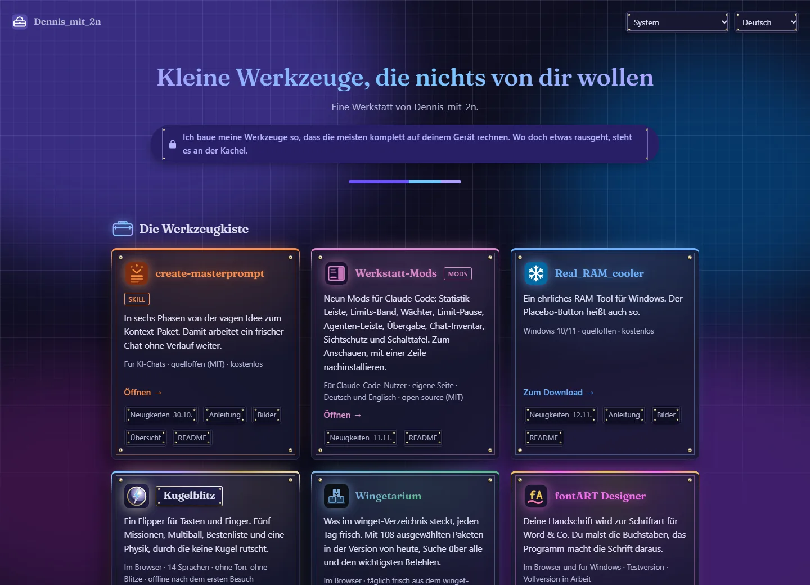

# dennismit2n.github.io

Landing page for the small tools by Dennis_mit_2n: no sign-up, no ads, free except fontART. Most of them run entirely on your device; where something leaves it, the tile says so. Most are open source; fontART is the exception.

Startseite für die kleinen Werkzeuge von Dennis_mit_2n: ohne Anmeldung, keine Anzeigen, kostenlos außer fontART. Die meisten rechnen komplett auf deinem Gerät; wo etwas es verlässt, steht es an der Kachel. Die meisten quelloffen; fontART ist die Ausnahme.

**➡️ [dennismit2n.github.io](https://dennismit2n.github.io/)**



## Tools

- [create-masterprompt](https://github.com/Dennismit2n/create-masterprompt): turns a vague project idea into a context package a fresh AI chat can run from (a skill, not a program)
- [Werkstatt-Mods](https://dennismit2n.github.io/mods.html): nine mods for Claude Code (statistics pane, limits band, guard, limit pause, agents pane, handoff, chat inventory, screen guard, switchboard), each installed with one line; its own page with screenshots, install lines and prompts (see below)
- [Real_RAM_cooler](https://github.com/Dennismit2n/Real_RAM_cooler): an honest RAM tool for Windows (download, not a browser tool)
- [Kugelblitz](https://dennismit2n.github.io/kugelblitz/): a pinball game for keys and fingers with five missions, multiball, high scores and physics no ball slips through, no sound and no flashes, offline after the first visit (on the gaming page as well)
- [Wingetarium](https://dennismit2n.github.io/wingetarium/): what is inside the official winget repository, fresh every day: 108 hand-picked packages at today’s version, a search across all packages, what is new and the key commands, offline after the first visit
- [fontART Designer](https://dennismit2n.github.io/fontART-demo/): turn your handwriting into a real font (trial version: in the browser, or as a Windows download)
- [Prismatical](https://dennismit2n.github.io/prismatical/): passwords and passphrases whose strength is the colour of the interface
- [Spectroton](https://dennismit2n.github.io/spectroton/): one colour in, eleven matching shades out, contrast-checked
- [shrinkling](https://dennismit2n.github.io/shrinkling/): shrink photos right in your browser
- [WiFi QR Card](https://dennismit2n.github.io/wifi-qr/): create a WiFi QR code card, guests scan and connect
- [Heizwarte](https://dennismit2n.github.io/heizwarte/): weather with a heating traffic light, tells you when to turn up slow heating (14 languages)
- [Hourbridge](https://dennismit2n.github.io/hourbridge/): UTC to German time and back, for any number of places, with a draggable timeline and clock change warnings, offline after the first visit
- [Follower-Log](https://dennismit2n.github.io/follower-log-vorlage/): who follows you on GitHub and who has left, as a template for your own private logbook with a small phone app (app in German)
- [Besucher-Ticker](https://github.com/Dennismit2n/besucher-ticker): your GoatCounter visitor numbers floating on the Windows desktop (download, not a browser tool)
- [Gaming](https://dennismit2n.github.io/gaming.html): its own page for game guides, handbooks and gaming tools (see below)
- [Zählwerk](https://dennismit2n.github.io/zaehlwerk/): where your Claude Code usage goes, by day, model and project
- [Pocketsum](https://dennismit2n.github.io/pocketsum/): five small calculators in one file: VAT, tips, fuel prices, dividends and trading costs, offline after the first visit
- [Collective-Calc](https://dennismit2n.github.io/collective-calc/): split group expenses, no account, shareable as a link
- [Dreh das Rad](https://dennismit2n.github.io/dreh-das-rad/): a decision wheel: options in, fate decides
- [bigday](https://dennismit2n.github.io/bigday/): pretty shareable countdown page
- [Fadenkreuz](https://github.com/Dennismit2n/fadenkreuz): your own crosshair in the exact centre of the screen, drawn in a small editor, on about 1 MB of RAM (Windows download, not a browser tool; on the gaming page as well)

Same order as the tiles on the page, hand-picked by Dennis, last reordered on 13 November 2026; new tools do not simply go to the end. Two further tiles sit at the end as placeholders, with no link and no mini tiles: there is nothing to open yet. Real_RAM_cooler, Besucher-Ticker and Fadenkreuz are Windows downloads and fontART comes both ways, which is why neither the headline nor the tiles promise a browser tool. fontART has one mini tile more than the others: its main button opens the browser version, and "For Windows" leads to the release. create-masterprompt has an extra one as well, opening the one-page overview from `docs/`, in whichever of the fourteen languages the page is currently set to. create-masterprompt is the first entry that is neither a browser tool nor a Windows program: it is an Agent Skill that runs inside an AI chat, which is why its button leads to the repository and its meta line does not borrow the "no uploads" line of the others.

**fontART is the odd one out**, and the tile says so rather than hiding it: it is the only tool here that is neither open source nor meant to stay free. What this repository links to is the free trial; the full version is being worked on, with no date and no price settled. The reasoning is spelled out in the guide on `werkstatt.html`, because a workshop whose footer says "open source on GitHub" owes an explanation for the one exception.

## Werkstatt-Mods page

Since 1 November 2026 the mods for Claude Code (five at first, nine since 11 November 2026) (repository [werkstatt-mods](https://github.com/Dennismit2n/werkstatt-mods), MIT) have their own page, `mods.html`, reached from the tile “Werkstatt-Mods” in second place, right after create-masterprompt (Dennis’ choice, 1 November 2026). Like Gaming it is a collection, so the tile has one mini tile only, the news. The page explains what a mod is, then shows each mod as a collapsible entry: a screenshot (`assets/mods/<name>.png`), what it does, its settings, the install line for the Claude Code prompt and a prompt in the page’s language that lets Claude do the install (`js/mods.js` fills the placeholders and runs the copy buttons). The mods themselves speak German and English; the page offers all fourteen languages and hands a visitor in any other language the English mod.

## Gaming page

Since 30 October 2026 everything to do with games lives on its own page, `gaming.html`, so it stays apart from the other tools. On the start page it is one tile, “Gaming”, at position 15: name, border and button in graphite, the cap a gradient from magenta through cherry red and neon blue to neon green. Its news mini tile shows the newest news date of the gaming apps and jumps to their section on `werkstatt.html`.

- [Kugelblitz](https://dennismit2n.github.io/kugelblitz/): my pinball game, first on the gaming page and at position 4 on the start page (14 languages, five appearances, offline after the first visit)
- [Craftionary](https://dennismit2n.github.io/craftionary/): every Minecraft recipe, where to find items and ores, ready `/give` commands and a banner and pot workshop (14 languages)
- [BL4 Vault-Handbuch](https://dennismit2n.github.io/bl4/): Borderlands 4 handbook, lives in `bl4/` of this repository (app in German, controls in 14 languages)
- [MW4 Rüstkammer](https://dennismit2n.github.io/mw4/): Call of Duty: Modern Warfare 4 builds and time to kill, lives in `mw4/` of this repository (app in German, controls in 14 languages)
- [Fadenkreuz](https://github.com/Dennismit2n/fadenkreuz): your own crosshair in the exact centre of the screen, drawn in a small editor, on about 1 MB of RAM (Windows download, not a browser tool). Since the evening of 30 October 2026 it is back on the start page as well, today at position 21.
- [Real_RAM_cooler](https://github.com/Dennismit2n/Real_RAM_cooler): also on the start page; its “Clean up for gaming” button is why it belongs here too
- a placeholder for the game guides still to come, with no link

Fadenkreuz’s tile stays black in both themes, like the dark placeholder: its neon green would be unreadable on the light page (1.20:1), so the tile carries fixed colours, and only its section on `werkstatt.html` follows the theme. On `werkstatt.html` the order follows the start page: Craftionary, BL4 and MW4 take the place of the Gaming tile, each with news, a guide and three phone screenshots, Fadenkreuz keeps its news and guide right after bigday, and Kugelblitz keeps its place from the start page. Their tiles and guides say what matters most for apps like these: they run in the browser on phones (Android and iOS) and on desktop, and an install button sets them up as an app (on an iPhone it is Safari’s Share and “Add to Home Screen”). The icons of BL4 and MW4 (`assets/bl4.svg`, `assets/mw4.svg`) are SVG redrawings of the apps’ own icons, so the profile README can embed them like every other tile icon. Since 30 October 2026, BL4 and MW4 carry their fonts in their own `fonts/` folders (Bangers, Barlow, Barlow Condensed and Share Tech Mono, SIL Open Font License, licence texts alongside) instead of loading them from Google Fonts, so opening them sends nothing to Google; their service workers store the Latin files on install, so the apps also look right offline. For MW4 the source is `tools/mw4/fonts/`, which `build.py` copies over. The BL4 handbook gets its weekly data (`bl4/weekly.json`) from a scheduled routine that commits straight to this repository.

## News and guides

`werkstatt.html` carries, for every tool, a short guide (what it is for, three steps, what to watch out for) and its dated release notes. Most tiles on the start page hold three mini tiles linking straight to the matching section (news, guide, screenshots), the news one showing the date of the newest entry. Since 12 November 2026 every tile carries one more, “README”, which opens the README of the tool’s repository on GitHub: the German one for German visitors where the repository has a `README.de.md`, otherwise the one GitHub shows. For the Gaming tile and the BL4 handbook it leads to the gaming section of this README, because they live in this repository. fontART, create-masterprompt and Besucher-Ticker (its phone app) have one further mini tile each, Werkstatt-Mods and Gaming have only news and README, and the two placeholder tiles have none because there is nothing to link to yet.

That is why a tile is a `<div>` rather than a link: `.tool-open` is stretched across the whole card via `::after`, so clicking anywhere still opens the tool, while the mini tiles stay clickable on top of it. A tile built from nested `<a>` elements would be invalid HTML.

Both come from hand-maintained data files, not from a feed: `js/news.js` and `js/guides.js`. **Only the Windows tools (Real_RAM_cooler, Besucher-Ticker, Fadenkreuz, Zählwerk Ticker), fontART and create-masterprompt have real GitHub releases.** The browser tools carry no tags, so their entries are written by hand and dated by the commit they describe. A guide may carry one optional extra section (`full`, an array of paragraphs); so far only fontART uses it, to say what the trial leaves out and why there is a price tag at all. Since 22 September 2026 a guide may also carry `shots`: screenshots shown under “What it looks like”, right after the purpose. The files are copies in `assets/anleitung/` rather than links into the tool repositories, so the page depends on no one else’s paths and the dev server shows them offline; every picture has its alt text in all 14 languages, and every screenshot opens at full size on click. create-masterprompt shows its overview in the reader’s language and Real_RAM_cooler its German or English window; the spinning wheel of Dreh das Rad plays once and stops (no full-size link: the file is only 360 px wide, wide screens already show it at nearly that size, and opening it would only replay it), and stays still for anyone who asked for reduced motion. Guides are written for people who want to *use* the tool; the READMEs stay what they are, developer documents, and are linked from each section.

The interface words exist in all 14 languages, and since 14 September 2026 so do the texts. Until then news and guides were German and English only, and every other language got the English version plus a notice saying so; that fallback and its notice are gone.

*Analytics (since 12 November 2026, tile clicks only):* the start page and `gaming.html` load [GoatCounter](https://www.goatcounter.com) and count **nothing but clicks on the tiles**: `kachel-ram` for a click on a tile, `kachel-ram-news`, `-anleitung`, `-bilder`, `-readme` and so on for the mini tiles inside it, each titled with the tool name. No page views (`no_onload`), no cookies, nothing anyone types in, nothing on `werkstatt.html` or `mods.html`, and nothing in the apps, PWAs and programs. `js/header.js` only sends names that fit this scheme, and only from links inside a tile, so a stray `data-count` anywhere else stays silent. Disclosed in the footer. The script is vendored unchanged in `js/vendor/count.js`, so no CDN is contacted; the only external request is the count beacon on a click. GoatCounter counts visitors per path, so one person clicking the same tile several times during one visit counts once. To leave your own clicks out, open the page once with `#toggle-goatcounter` at the end of the address (GoatCounter’s own switch, stored in that browser). From 3 to 12 November 2026 nothing was counted at all. [Besucher-Ticker](https://github.com/Dennismit2n/besucher-ticker) 1.3.0 shows these clicks per tool on the desktop.

*Look (since 30 October 2026):* the tiles fill the width of the window, one column on a phone, up to five on a wide screen (the page is at most 1680 px wide, the hero stays narrow). Behind everything, four soft colour clouds drift slowly over the construction grid of the blueprint drawing from the profile README; they stand still for anyone who has asked their system for reduced motion. The clouds carry a lot of colour but little brightness, so text that stands directly on them keeps 4.6:1 even where two of them overlap. Every tile glows in its own colour (a haze from its colour cap, a soft light around the top edge and its icon). The light theme is deliberately muted (background `#DADBE6` instead of near-white), and every tile colour was recalculated for it; the hues of tiles that looked alike (Real_RAM_cooler, Heizwarte and WiFi QR Card, shrinkling and Besucher-Ticker, Zählwerk and Collective-Calc) were pulled apart. The section headings carry drawn icons instead of emoji: the flat toolbox from the profile README, and a gamepad on the gaming page.

*Fittings (since 11 November 2026):* inside its rounded outline every tile carries a square frame, like a plate screwed on, with a small white gold screw in each corner. The mini tiles carry the same in small. The light comes from the top right, so the shadows of tiles and screws fall to the bottom left, and each screw sits at its own angle, tightened by hand rather than aligned. The frame hangs on `.tool-open::before` (the tile’s own `::before` and `::after` already hold the cap and the glow) and takes no clicks; the four screws are small inline SVGs, `--schraube-1` to `--schraube-4` in `css/style.css`. The cards of the profile README and the promo images carry the same fittings. Since 12 November 2026 everything else with a border carries them too: the two dropdowns in the header, the pledge, the sections and picture frames on `werkstatt.html`, and the cards, code boxes and copy buttons on `mods.html`. There the fittings are background layers (`--beschlag`, eight layers: four screws, four lines) instead of a pseudo-element, because a `<select>` has no `::before`; the picture frames carry them as `::after` on top of the picture. Every box, the placeholders included, now casts its shadow to the bottom left. Kugelblitz (since 13 November 2026) carries one fitting more: its name stands, light as the score in the game, on a small dark name plate with a white gold frame and four tiny screws, like the plaque on its pinball table. The plate stays dark in both themes, and its cap runs through the colours of the game: ice blue, lavender, gold and white gold.

*Display modes (since 31 October 2026):* the appearance menu offers eight entries: System, Light, Dark, High contrast dark, High contrast light, Colour-blind dark, Colour-blind light and Inverted colours. The choice is stored as `werkstatt.darstellung` in localStorage and holds for every tool of the workshop, because they all live on this origin (the old key `dennismit2n-home.theme` is still read as a fallback). A small script in the `<head>` of each page turns it into two attributes before the first paint: `data-theme` (light or dark, as before) and `data-vision` (`contrast`, `cvd` or `invert`); `js/header.js` does the same at runtime and follows the system live. *System* also follows the device setting “increase contrast” and then shows high contrast. High contrast drops the clouds, glows, translucency and gradients; text is `#E0E0E0` on black or black on white, and every colour holds 7:1. This page has no colours that carry meaning, so colour-blind looks like light or dark here; the tools swap their meaning colours themselves. Inverted colours works like the colour filter of Windows (`filter: invert(1)` on the page); screenshots are flipped back so they stay true. Inverting does not keep WCAG contrast, so a few tile colours are lightened in that mode until they hold 4.5:1 after the flip. The three colour blocks at the top of `css/style.css` stay untouched; the modes live in their own blocks at the end of the file.

*Texts (since 1 November 2026):* every visible text of the workshop, on this page and in the tools, does without dashes as punctuation, in all 14 languages. Ranges like 1–10 stay.

*Counting (since 3 November 2026):* nothing on this page or in the tools counts visits or clicks any more. The `data-count` attributes in the markup are inert, `js/header.js` only acts on them if a counter were loaded, and none is.

*Deliberately absent:* no service worker and no web manifest. The sister projects have both; this page does not, to avoid the cache-version trap on every deploy. So the page is not installable and does not work offline.

*Typeface:* names and headings are set in [Fraunces](https://github.com/undercasetype/Fraunces) (SIL Open Font License 1.1), including the brand and the tool list in the navigation of `werkstatt.html`; running text, buttons and form controls stay in the system font. The font is self-hosted in `assets/fonts/fraunces/` next to its licence, so no font service is contacted. Only the weight axis ships: 36 KB for Latin, plus 33 KB where Polish, Turkish and the like need it. Fraunces has no Cyrillic, Devanagari or CJK letters, so Russian, Hindi, Chinese, Japanese and Korean headings, and translated tool names, stay in the system font.

## Development

No build step: plain HTML, CSS, and JavaScript. 110 files make up the site (not counting the apps in `bl4/` and `mw4/`, the `heizwarte/` helper and `tools/`): four pages, one stylesheet, nine scripts (one of them GoatCounter’s, vendored), twenty-nine images plus the nine mod screenshots in `assets/mods/`, three icons, fifty-two screenshots for the guides in `assets/anleitung/`, and two font files with their licence in `assets/fonts/fraunces/`. No npm dependencies.

```
node tools/dev-server.js
```

Then open http://localhost:8615

The stylesheet and every own script are pulled in with a `?v=<date>` suffix. GitHub Pages serves
HTML and code with `max-age=600` and caches them independently, so without the suffix a freshly
deployed `index.html` can meet a ten-minute-old `i18n.js` and render raw keys instead of text.
**Bump the date in every HTML file whenever a deploy changes CSS or JS**, and append a letter for a second deploy on the same day (`…-13b`). `js/vendor/count.js` deliberately has no suffix: it is third-party code and never changes. `news.js` is loaded by `index.html`, `gaming.html` and `werkstatt.html`, so its stamp lives in three places.

## Preview and promo images

`tools/promo/` renders the preview and promo images for the workshop from one shared template: 253 images, ten formats per tool (link preview, GitHub social preview, Instagram, LinkedIn, X, three story cards, Twitch panel, Twitch banner) plus thirteen brand images (avatars and profile banners), in the design of the start page since 30 October 2026. It knows all 21 tiles and the start page plus the Zählwerk Ticker and the Besucher-Ticker App. Colours come straight from `css/style.css`, the icons are the same SVGs as the tiles. Everything editable lives in `tools/promo/marke.mjs`; see `tools/promo/README.md`.

## Translations

The page speaks 14 languages (`js/i18n.js`), and so do the news and guides (`js/news.js`, `js/guides.js`). Some translations are machine-generated. Corrections are very welcome.

## License

[MIT](LICENSE) for everything in this repository, with two exceptions: `js/vendor/count.js` is GoatCounter’s counter script and is released under the ISC license, as stated in its file header; and the font files in `assets/fonts/fraunces/` are Fraunces by The Fraunces Project Authors, licensed under the SIL Open Font License 1.1 (see `OFL.txt` there).
